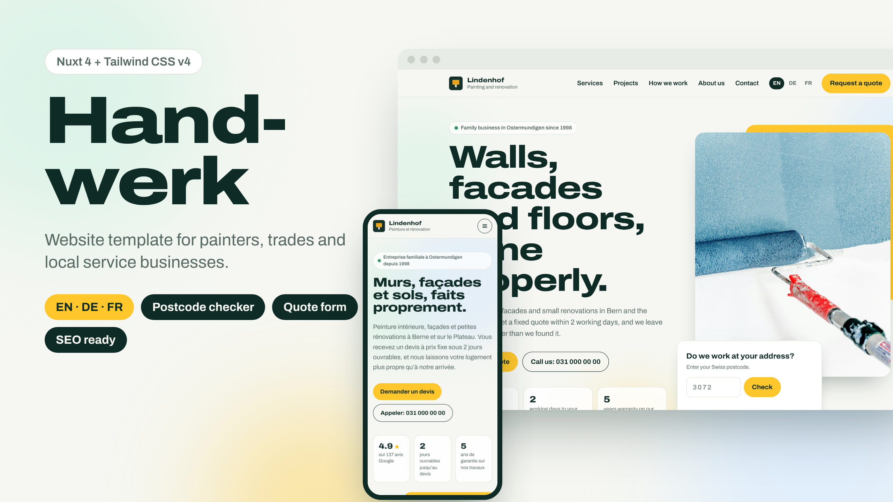

# Handwerk Lite – free Nuxt 4 template for local trade businesses

A clean, fast website for painters, electricians, plumbers and other local service businesses. Built with **Nuxt 4** and **Tailwind CSS v4**, generated as a static site.

**Live demo of the full version:** https://handwerk-nuxt-demo.netlify.app



## What's included in Lite

- Home page: hero, services price table, recent projects, how-we-work steps, reviews, service area, FAQ and quote form
- A detail page for each service
- Postcode checker: visitors see whether you work in their area and if a travel fee applies
- Quote form with validation and a spam honeypot (works with Formspree, Basin, Web3Forms)
- SEO basics: meta tags, LocalBusiness JSON-LD, sitemap.xml
- All content in small TypeScript data files, so you never have to touch components

## Lite vs. full version

| | Lite (free) | [Handwerk](https://stavreva68.gumroad.com/l/handwerk-nuxt-template) |
|---|---|---|
| Home, service pages, quote form | ✅ | ✅ |
| Postcode checker | ✅ | ✅ |
| Languages | English | **English, German, French** with hreflang |
| Pages | Home, services, contact | + About, services overview, imprint, privacy, 404 |
| Animations | – | Headline reveal, scroll reveals, count-up stats, town marquee |
| Sitemap with language alternates | – | ✅ |
| Support | GitHub issues | Email support, free v1.x updates |

👉 **[Get the full version – $49](https://stavreva68.gumroad.com/l/handwerk-nuxt-template)**

## Quick start

```bash
npm install
npm run dev        # http://localhost:3000
npm run generate   # static site in .output/public
```

## Make it yours

| File | What to edit |
| --- | --- |
| `app/data/site.ts` | Company name, phone, email, address, rating, form endpoint, travel fee |
| `app/data/services.ts` | Services, prices, photos and texts |
| `app/data/content.ts` | Projects, reviews, FAQ |
| `app/data/area.ts` | Towns and postcodes for the postcode checker |
| `i18n/locales/en.json` | Interface text |
| `app/assets/css/main.css` | Colours and font (the `@theme` block) |

To connect the quote form, paste your Formspree (or similar) URL into `formEndpoint` in `site.ts`. When it's empty the form runs in demo mode.

## Deploy

Run `npm run generate` and upload `.output/public` to Netlify, Vercel, Cloudflare Pages or any static host.

## Credits

Demo photos from [Unsplash](https://unsplash.com) (loaded from Unsplash, not included). Font: Archivo (SIL OFL). The demo company is fictional.

## Licence

MIT. Use it for personal and commercial projects. A link back is appreciated but not required.

Made by [Pavlina Stavreva](https://pavlinastavreva.ch).
